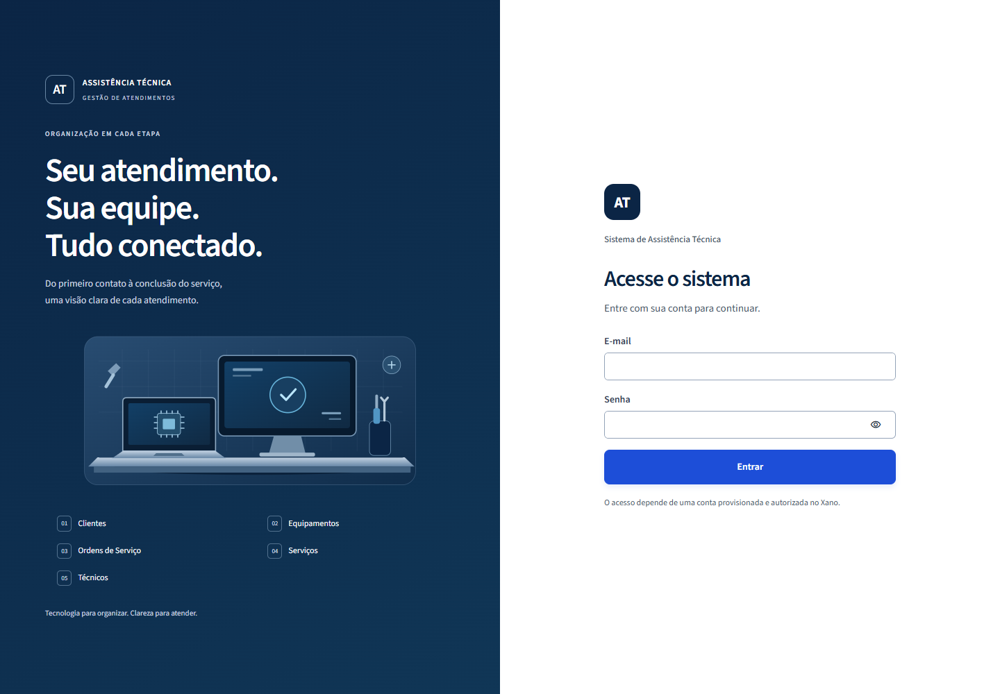

# Sistema de Assistência Técnica

**Vision Tech — ADS 2º B**

**Integrantes:**

- André Santos de Oliveira
- Giovanni Monarin Pinheiro
- Emerson da Silva Celestino

Esta versão para avaliação pública é uma seleção revisada dos arquivos do projeto, sem o histórico Git original. A preparação local não significa que o repositório ou o aplicativo já tenham sido publicados.

## 1. Apresentação

Aplicação acadêmica para organizar uma assistência técnica: cadastrar clientes e equipamentos, distribuir ordens de serviço entre técnicos e registrar os serviços executados.

O sistema atende uma única assistência técnica e possui cinco módulos: **Clientes, Equipamentos, Técnicos, Ordens de Serviço e Serviços**. O painel **Minhas Ordens** oferece ao técnico a consulta dos atendimentos atribuídos a ele.

### Tecnologias e arquitetura

| Tecnologia | Papel no projeto |
| --- | --- |
| Python | Aplicação e integração com as APIs |
| Streamlit | Interface, formulários e navegação por perfil |
| Xano | Backend, autenticação, autorização, APIs e persistência |
| XanoScript | Representação das definições do backend em arquivos |
| Git e GitHub | Controle de versão e compartilhamento |
| OpenSpec | Organização das especificações e do desenvolvimento incremental |

**Fluxo de acesso:** navegador → Streamlit/Python → APIs HTTPS do Xano → dados. A autorização é aplicada no backend; a navegação também é filtrada pelo perfil.

Um Cliente possui Equipamentos; cada Ordem de Serviço relaciona um Equipamento e um Técnico; cada Serviço pertence a uma Ordem de Serviço.

Documentos públicos previstos, ainda pendentes de inclusão: [visão do projeto](docs/arquitetura.md) e [modelo de domínio](docs/modelo-dominio.md).

## 2. Acesso ao aplicativo

**Não há versão publicada do aplicativo.** A execução é local e depende do backend Xano privado e de uma conta previamente autorizada. Instalar o frontend não cria o backend nem usuários.

**Vídeo de demonstração:** [Assistir à apresentação do Vision Tech](https://youtu.be/GawhcxvqhPY). O funcionamento com o backend será apresentado nesse material.

### Instalação no Windows

Requisitos: Python instalado, terminal na raiz do projeto e internet para obter dependências e acessar o backend durante o uso real. O ambiente documentado utiliza Python 3.13 e Streamlit 1.66; outras versões não são declaradas como verificadas.

```powershell
py -3.13 -m venv .venv
.\.venv\Scripts\python.exe -m pip install -r frontend\requirements.txt
```

As dependências declaradas são `streamlit>=1.40,<2` e `requests>=2.32,<3`. Como o arquivo usa intervalos, uma instalação nova pode resolver versões diferentes. Não recrie o ambiente virtual se ele já estiver preparado.

### Configuração e execução

O responsável deve fornecer os endereços HTTPS dos grupos de APIs e configurá-los nas variáveis de ambiente do processo:

| Variável | Grupo |
| --- | --- |
| `XANO_AUTH_API_BASE_URL` | Autenticação |
| `XANO_CLIENTES_API_BASE_URL` | Clientes |
| `XANO_EQUIPAMENTOS_API_BASE_URL` | Equipamentos |
| `XANO_TECNICOS_API_BASE_URL` | Técnicos |
| `XANO_ORDENS_API_BASE_URL` | Ordens de Serviço |
| `XANO_SERVICOS_API_BASE_URL` | Serviços |

Os valores não são distribuídos neste README. O aplicativo lê as variáveis do processo; não há carregamento automático de `.env`. Não inserir senhas ou tokens nos endereços das APIs.

O ponto de entrada é **`frontend/Clientes.py`**, que inicia o portal completo:

```powershell
.\.venv\Scripts\python.exe -m streamlit run frontend/Clientes.py --server.address 127.0.0.1 --browser.gatherUsageStats false
```

Abra o endereço local mostrado no terminal. Para encerrar o processo iniciado, use `Ctrl+C` no mesmo terminal.


> **Capturas do login:** imagens da prévia isolada do Streamlit, sem credenciais preenchidas, autenticação real ou sessão integrada com o backend. Não são evidência de autenticação ou persistência.




## 3. Perfis de usuários

| Perfil | Acesso |
| --- | --- |
| **Colaborador** (`colaborador`) | Gestão dos cinco módulos |
| **Técnico** (`tecnico`) | Consulta das OS atribuídas e atualização de status em Minhas Ordens |

O responsável pela gestão utiliza o perfil Colaborador. Cadastrar um Técnico não cria sua conta de acesso: a identidade precisa de perfil e vínculo técnico válidos. Usuários sem perfil funcional não recebem acesso administrativo.

Não há cadastro público, opção de lembrar acesso ou recuperação de senha na interface. Contas e permissões são administradas pelo responsável.

## 4. Funcionalidades

| Tela | Operações disponíveis |
| --- | --- |
| **Clientes** | Listar, cadastrar, consultar, editar e excluir, respeitando dependências |
| **Equipamentos** | Listar, cadastrar, consultar e editar; excluir quando a configuração permite e não há impedimento por OS vinculada |
| **Técnicos** | Listar, cadastrar, consultar e editar |
| **Ordens de Serviço** | Listar, filtrar por status, técnico e busca; cadastrar, consultar e editar |
| **Serviços** | Listar, cadastrar, consultar, editar e excluir serviços vinculados a uma OS |
| **Minhas Ordens** | Consultar OS atribuídas ao técnico autenticado e atualizar seu status |

As OS possuem problema relatado, status, datas de entrada e saída, valor total e vínculos com Equipamento e Técnico. Os estados previstos incluem Aguardando avaliação, Em manutenção, Aguardando peça, Concluída e Entregue. O rótulo Concluída corresponde ao valor interno `Concluído`.

### Disponibilidade por configuração

- Sem endereço válido de autenticação, o envio do login permanece desabilitado. Cada módulo depende também do endereço de seu grupo de APIs.
- A exclusão de Equipamentos exige `XANO_EQUIPAMENTOS_DELETE_VALIDATED=true`. Na execução manual, ela não é habilitada por padrão. A configuração deve ser fornecida explicitamente pelo responsável, somente para um backend em que a operação já tenha sido verificada. A configuração dos endereços das APIs, por si só, não habilita a exclusão.
- **Exclusões de Técnicos e de OS continuam indisponíveis por segurança no backend.** Há controles preparados na interface, mas sua presença não significa que essas operações estejam liberadas. Não utilizá-los na demonstração.
- O acesso depende do perfil autorizado, mesmo com os endereços das APIs configurados.

## 5. Manual de utilização por jornada

### Gestor — perfil Colaborador

1. Entre com sua conta autorizada e escolha o módulo na navegação lateral.
2. Em **Clientes**, cadastre ou consulte o proprietário do equipamento.
3. Em **Equipamentos**, registre o equipamento relacionado ao Cliente e anote seu ID.
4. Em **Técnicos**, confira ou cadastre o profissional responsável e anote seu ID.
5. Em **Ordens de Serviço**, preencha o problema, os IDs de Equipamento e Técnico, status, data de entrada e valor total. Informe a data de saída quando aplicável e envie o formulário.
6. Utilize a listagem e a consulta individual para acompanhar ou editar o atendimento. Ao trocar de OS, carregue os dados da nova seleção antes de editar.
7. Em **Serviços**, registre descrição e valor, informando o ID da OS correspondente.
8. Ao terminar, utilize **Sair** na navegação lateral.

Para exclusões disponíveis, carregue o registro correto e siga a confirmação apresentada. Se uma operação tiver resultado incerto, utilize a conferência indicada na tela antes de tentar novamente.

> **Captura a inserir:** formulário real de cadastro de OS, com dados fictícios e sem informações pessoais.

### Técnico

1. Entre com sua conta autorizada e vinculada ao cadastro correto.
2. Abra **Minhas Ordens** e utilize **Atualizar minhas ordens** para consultar os atendimentos atribuídos.
3. Consulte o equipamento, o problema relatado e o status.
4. Selecione o status desejado e pressione **Salvar status**. Confira a mensagem apresentada antes de continuar.
5. Utilize **Sair** ao terminar.

O Técnico não acessa a gestão administrativa dos cinco módulos nem as OS atribuídas a outros técnicos.

> **Captura a inserir:** painel técnico real em 390 px, mostrando somente dados fictícios.

## 6. Exemplos de utilização

**Recebimento:** um cliente fictício entrega um notebook que não liga. O Colaborador cadastra o Cliente, registra o Equipamento e abre uma OS com o problema “Notebook não liga”, relacionando o Técnico pelos IDs existentes.

**Acompanhamento:** o Técnico consulta a OS atribuída e atualiza o status para Em manutenção. Se precisar de uma peça, pode informar Aguardando peça. O Colaborador acompanha o atendimento na gestão de OS.

**Serviço e entrega:** o Colaborador registra “Substituição do conector de alimentação” e seu valor, vinculando o Serviço à OS. Depois da conclusão e entrega, atualiza os dados do atendimento e informa a saída quando aplicável. O valor total da OS é informado no formulário; não há soma automática dos Serviços.

Os exemplos não criam registros automaticamente. Na apresentação, utilize dados fictícios e preserve os registros existentes.

## 7. Limitações conhecidas e melhorias futuras

### Limitações atuais

- Exclusão de Técnico e de OS indisponível por segurança. O escopo integral previsto permanece pendente enquanto essas operações não forem disponibilizadas.
- Equipamento e Técnico são informados por ID nos formulários de OS; outros relacionamentos também utilizam identificadores.
- Sem versão publicada; o uso real depende de configuração local, backend Xano privado e conta autorizada.
- O vídeo de demonstração ainda precisa de referência pública.
- Atendimento de uma única assistência técnica, sem separação operacional entre empresas.
- Sem cálculo automático do valor total da OS a partir dos Serviços.
- Verificações adicionais de segurança permanecem pendentes; esta documentação não declara seu encerramento integral.
- Esta seleção revisada não inclui o histórico Git original e ainda aguarda autorização de publicação.

### Melhorias futuras

- Substituir IDs por seletores com nomes nos formulários.
- Definir a regra de alteração de status para OS concluída.
- Concluir a disponibilização segura das exclusões de Técnicos e OS.

Essas melhorias não são funcionalidades disponíveis. Não compartilhar ambientes virtuais, configurações pessoais, senhas, tokens, logs brutos ou capturas com dados pessoais.


## 8. Estrutura e documentação do projeto

O repositório contém uma seleção revisada dos arquivos do desenvolvimento acadêmico.

### OpenSpec

A pasta `openspec/` reúne o planejamento incremental do sistema:

- `openspec/specs/`: especificações das funcionalidades.
- `openspec/changes/`: propostas, decisões técnicas e tarefas de evolução.
- `openspec/changes/archive/`: alterações arquivadas durante o desenvolvimento.

### XanoScript

A pasta `xano/` contém uma seleção das definições do backend Xano:

- `xano/api/`: definições de endpoints dos módulos.
- `xano/function/`: funções auxiliares.
- `xano/table/`: definições de tabelas.

Esses arquivos documentam parte da implementação e não constituem um backup completo do workspace Xano.

### Orientações para desenvolvimento

O arquivo `AGENTS.md` registra instruções e convenções utilizadas no desenvolvimento.

### Histórico de versões

Este repositório público utiliza um histórico Git independente do projeto original, para evitar a publicação de informações sensíveis presentes em versões anteriores.


## 9. Desenvolvimento com Codex e OpenSpec

O projeto utilizou o Codex como assistente de programação, em conjunto com o OpenSpec para organizar o desenvolvimento incremental.

### Habilidades do Codex

A pasta `.agents/skills/` contém seis habilidades do OpenSpec:

- `openspec-explore`: exploração de ideias e requisitos.
- `openspec-propose`: elaboração de propostas de alteração.
- `openspec-apply-change`: implementação das alterações planejadas.
- `openspec-update-change`: atualização das propostas existentes.
- `openspec-sync-specs`: sincronização das especificações.
- `openspec-archive-change`: arquivamento das alterações concluídas.

O arquivo `AGENTS.md` reúne orientações para o trabalho com agentes de programação.

As propostas, tarefas, especificações e alterações arquivadas podem ser consultadas na pasta `openspec/`.

