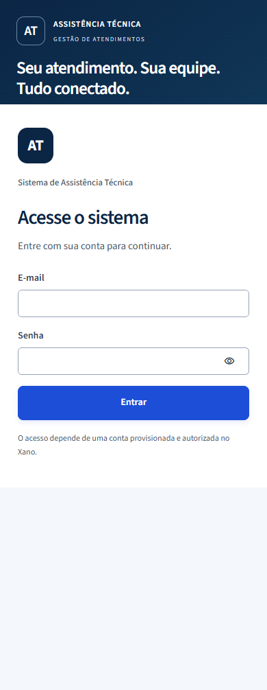

# Sistema de Assistência Técnica

**Vision Tech — ADS 2º B**

**Integrantes:**

- André Santos de Oliveira
- Giovanni Monarin Pinheiro
- Emerson da Silva Celestino

O **Vision Tech** é um sistema de gestão desenvolvido para centralizar e organizar as operações de uma assistência técnica, integrando o gerenciamento de clientes, equipamentos, técnicos, ordens de serviço e serviços executados em uma única plataforma.

A solução oferece uma interface administrativa para controle dos atendimentos e um painel dedicado aos técnicos, permitindo consultar ordens de serviço atribuídas e atualizar o andamento das atividades conforme as permissões de acesso.

Desenvolvido com **Python e Streamlit**, integrado ao backend **Xano**, o sistema adota uma arquitetura baseada em APIs, com controle de acesso por perfil e organização dos dados em módulos interligados.

## 1. Apresentação

Aplicação com o objetivo de organizar uma assistência técnica: cadastrar clientes e equipamentos, distribuir ordens de serviço entre técnicos e registrar os serviços executados.

O sistema atende uma única assistência técnica e possui cinco módulos: **Clientes, Equipamentos, Técnicos, Ordens de Serviço e Serviços**. O painel **Minhas Ordens** oferece ao técnico a consulta dos atendimentos atribuídos a ele.

### Tecnologias e arquitetura

| Tecnologia | Papel no projeto |
| --- | --- |
| Python | Aplicação e integração com as APIs |
| Streamlit | Interface, formulários e navegação por perfil |
| Xano | Backend, autenticação, autorização, APIs e persistência |
| XanoScript | Representação das definições do backend em arquivos |
| Git e GitHub | Controle de versão e compartilhamento |
| OpenSpec | Organização das especificações e do desenvolvimento incremental |

**Fluxo de acesso:** navegador → Streamlit/Python → APIs HTTPS do Xano → dados. A autorização é aplicada no backend; a navegação também é filtrada pelo perfil.

Um Cliente possui Equipamentos; cada Ordem de Serviço relaciona um Equipamento e um Técnico; cada Serviço pertence a uma Ordem de Serviço.

Documentos públicos previstos, ainda pendentes de inclusão: [visão do projeto](docs/arquitetura.md) e [modelo de domínio](docs/modelo-dominio.md).

## 2. Acesso ao aplicativo

**Não há versão publicada do aplicativo.** A execução é local e depende do backend Xano privado e de uma conta previamente autorizada. Instalar o frontend não cria o backend nem usuários.

**Vídeo de demonstração:** [Assistir à apresentação do Vision Tech](https://youtu.be/GawhcxvqhPY). O funcionamento com o backend será apresentado nesse material.

### Instalação no Windows

Requisitos: Python instalado, terminal na raiz do projeto e internet para obter dependências e acessar o backend durante o uso real. O ambiente documentado utiliza Python 3.13 e Streamlit 1.66; outras versões não são declaradas como verificadas.

```powershell
py -3.13 -m venv .venv
.\.venv\Scripts\python.exe -m pip install -r frontend\requirements.txt
```

As dependências declaradas são `streamlit>=1.40,<2` e `requests>=2.32,<3`. Como o arquivo usa intervalos, uma instalação nova pode resolver versões diferentes. Não recrie o ambiente virtual se ele já estiver preparado.

### Configuração e execução

O responsável deve fornecer os endereços HTTPS dos grupos de APIs e configurá-los nas variáveis de ambiente do processo:

| Variável | Grupo |
| --- | --- |
| `XANO_AUTH_API_BASE_URL` | Autenticação |
| `XANO_CLIENTES_API_BASE_URL` | Clientes |
| `XANO_EQUIPAMENTOS_API_BASE_URL` | Equipamentos |
| `XANO_TECNICOS_API_BASE_URL` | Técnicos |
| `XANO_ORDENS_API_BASE_URL` | Ordens de Serviço |
| `XANO_SERVICOS_API_BASE_URL` | Serviços |

Os valores não são distribuídos neste README. O aplicativo lê as variáveis do processo; não há carregamento automático de `.env`. Não inserir senhas ou tokens nos endereços das APIs.

O ponto de entrada é **`frontend/Clientes.py`**, que inicia o portal completo:

```powershell
.\.venv\Scripts\python.exe -m streamlit run frontend/Clientes.py --server.address 127.0.0.1 --browser.gatherUsageStats false
```

Abra o endereço local mostrado no terminal. Para encerrar o processo iniciado, use `Ctrl+C` no mesmo terminal.


> **Capturas do login:** imagens da prévia isolada do Streamlit, sem credenciais preenchidas, autenticação real ou sessão integrada com o backend. Não são evidência de autenticação ou persistência.




## 3. Perfis de usuários

| Perfil | Acesso |
| --- | --- |
| **Colaborador** (`colaborador`) | Gestão dos cinco módulos |
| **Técnico** (`tecnico`) | Consulta das OS atribuídas e atualização de status em Minhas Ordens |

O responsável pela gestão utiliza o perfil Colaborador. Cadastrar um Técnico não cria sua conta de acesso: a identidade precisa de perfil e vínculo técnico válidos. Usuários sem perfil funcional não recebem acesso administrativo.

Não há cadastro público, opção de lembrar acesso ou recuperação de senha na interface. Contas e permissões são administradas pelo responsável.

## 4. Funcionalidades

| Tela | Operações disponíveis |
| --- | --- |
| **Clientes** | Listar, cadastrar, consultar, editar e excluir, respeitando dependências |
| **Equipamentos** | Listar, cadastrar, consultar e editar; excluir quando a configuração permite e não há impedimento por OS vinculada |
| **Técnicos** | Listar, cadastrar, consultar e editar |
| **Ordens de Serviço** | Listar, filtrar por status, técnico e busca; cadastrar, consultar e editar |
| **Serviços** | Listar, cadastrar, consultar, editar e excluir serviços vinculados a uma OS |
| **Minhas Ordens** | Consultar OS atribuídas ao técnico autenticado e atualizar seu status |

As OS possuem problema relatado, status, datas de entrada e saída, valor total e vínculos com Equipamento e Técnico. Os estados previstos incluem Aguardando avaliação, Em manutenção, Aguardando peça, Concluída e Entregue. O rótulo Concluída corresponde ao valor interno `Concluído`.

### Disponibilidade por configuração

- Sem endereço válido de autenticação, o envio do login permanece desabilitado. Cada módulo depende também do endereço de seu grupo de APIs.
- A exclusão de Equipamentos exige `XANO_EQUIPAMENTOS_DELETE_VALIDATED=true`. Na execução manual, ela não é habilitada por padrão. A configuração deve ser fornecida explicitamente pelo responsável, somente para um backend em que a operação já tenha sido verificada. A configuração dos endereços das APIs, por si só, não habilita a exclusão.
- **Exclusões de Técnicos e de OS continuam indisponíveis por segurança no backend.** Há controles preparados na interface, mas sua presença não significa que essas operações estejam liberadas. Não utilizá-los na demonstração.
- O acesso depende do perfil autorizado, mesmo com os endereços das APIs configurados.

## 5. Manual de utilização por jornada

### 5.1. Acesso ao sistema

1. Execute o aplicativo Streamlit conforme as instruções de instalação.
2. Abra o endereço local apresentado no terminal.
3. Informe as credenciais de uma conta previamente autorizada.
4. Após a autenticação, utilize os módulos disponíveis para o seu perfil.

**Resultado esperado:** o usuário acessa apenas as funcionalidades permitidas para seu perfil. O acesso depende da configuração e disponibilidade do backend Xano.

### 5.2. Jornada do Colaborador

#### Cadastrar e consultar clientes

1. Acesse o módulo **Clientes**.
2. Utilize o formulário para cadastrar o proprietário do equipamento.
3. Confirme o cadastro e consulte o registro na listagem.
4. Quando necessário, selecione o cliente para consultar ou editar suas informações.

**Resultado esperado:** o cliente é registrado e pode ser associado a equipamentos. Exclusões devem respeitar os vínculos existentes.

#### Cadastrar e consultar equipamentos

1. Acesse **Equipamentos**.
2. Informe os dados solicitados e o vínculo com o Cliente.
3. Confirme o cadastro e consulte o equipamento na listagem.
4. Anote o identificador do equipamento para utilizá-lo na Ordem de Serviço.

**Resultado esperado:** o equipamento fica associado ao cliente correspondente.

#### Cadastrar e consultar técnicos

1. Acesse **Técnicos**.
2. Cadastre ou consulte o profissional responsável pelo atendimento.
3. Confira os dados e anote o identificador do técnico.
4. Utilize as opções disponíveis para editar o cadastro quando necessário.

**Resultado esperado:** o técnico fica registrado para associação às Ordens de Serviço. O cadastro não cria automaticamente uma conta de acesso.

#### Abrir uma Ordem de Serviço

1. Acesse **Ordens de Serviço**.
2. Informe o problema relatado pelo cliente.
3. Preencha os identificadores de Equipamento e Técnico.
4. Informe o status, a data de entrada e o valor total.
5. Informe a data de saída quando aplicável.
6. Confirme o cadastro.

**Resultado esperado:** a OS fica vinculada ao equipamento e ao técnico selecionados, conforme as validações do backend.

#### Consultar e atualizar uma Ordem de Serviço

1. Abra **Ordens de Serviço**.
2. Utilize a listagem e os filtros disponíveis para localizar o atendimento.
3. Carregue os dados da OS selecionada antes de editar.
4. Atualize as informações permitidas e confirme.

**Resultado esperado:** os dados autorizados são atualizados e podem ser conferidos em nova consulta.

#### Registrar um serviço executado

1. Acesse **Serviços**.
2. Informe a descrição do serviço e seu valor.
3. Informe o identificador da Ordem de Serviço correspondente.
4. Confirme o cadastro e consulte o serviço registrado.

**Resultado esperado:** o serviço fica associado à OS. O valor total da OS não é recalculado automaticamente pela soma dos serviços.

### 5.3. Jornada do Técnico

#### Consultar minhas ordens

1. Entre com uma conta autorizada e vinculada ao cadastro do técnico.
2. Acesse **Minhas Ordens**.
3. Clique em **Atualizar minhas ordens**.
4. Selecione o atendimento para consultar equipamento, problema e status.

**Resultado esperado:** o técnico visualiza somente as Ordens de Serviço atribuídas a ele.

#### Atualizar o status do atendimento

1. Em **Minhas Ordens**, selecione a OS atribuída.
2. Escolha o status permitido para o atendimento.
3. Clique em **Salvar status**.
4. Confira a mensagem de retorno e consulte novamente o registro quando necessário.

**Resultado esperado:** o status é atualizado quando a operação é autorizada e validada pelo backend.

### 5.4. Encerramento e cuidados de utilização

1. Utilize **Sair** na navegação lateral ao finalizar o atendimento.
2. Não compartilhe credenciais ou tokens de autenticação.
3. Antes de repetir uma operação cujo resultado seja incerto, consulte o registro para evitar duplicidades.
4. Utilize dados fictícios nas demonstrações acadêmicas.

**Observação:** as exclusões de Técnicos e Ordens de Serviço permanecem indisponíveis por segurança. A exclusão de Equipamentos depende de validação prévia e configuração específica do backend.


## 6. Exemplos de utilização

### Cenário demonstrativo — manutenção de notebook

Considere um cliente fictício que procura a assistência técnica porque seu notebook não liga. O exemplo apresenta o fluxo de atendimento do Vision Tech, utilizando dados fictícios.

#### Etapa 1 — Recebimento e cadastro

1. O Colaborador acessa o módulo **Clientes** e cadastra ou consulta o proprietário.
2. Em **Equipamentos**, registra o notebook e o associa ao cliente.
3. Em **Técnicos**, identifica o profissional responsável pelo atendimento.

**Resultado esperado:** cliente, equipamento e técnico ficam registrados, com seus respectivos identificadores.

#### Etapa 2 — Abertura da Ordem de Serviço

1. O Colaborador acessa **Ordens de Serviço**.
2. Informa o problema relatado: `Notebook não liga`.
3. Associa os identificadores do equipamento e do técnico.
4. Informa a data de entrada, o status **Aguardando avaliação** e o valor total conforme o atendimento.
5. Confirma o cadastro.

**Resultado esperado:** a Ordem de Serviço fica registrada e vinculada ao equipamento e ao técnico.

#### Etapa 3 — Acompanhamento da manutenção

1. O Técnico entra no sistema com sua conta autorizada.
2. Acessa **Minhas Ordens** e consulta os atendimentos atribuídos.
3. Localiza a OS do notebook e atualiza seu status para **Em manutenção**, quando permitido.
4. Caso dependa de uma peça, pode selecionar **Aguardando peça**.

**Resultado esperado:** o andamento fica registrado e pode ser acompanhado pelo Colaborador.

#### Etapa 4 — Registro do serviço executado

1. O Colaborador acessa **Serviços**.
2. Registra a descrição fictícia `Substituição do conector de alimentação` e o respectivo valor.
3. Vincula o serviço ao identificador da OS.
4. Consulta o registro para conferir o vínculo.

**Resultado esperado:** o serviço fica associado à OS. O valor total da Ordem de Serviço é informado separadamente e não é calculado automaticamente pela soma dos serviços.

#### Etapa 5 — Conclusão e entrega

1. Após a manutenção, o atendimento pode avançar para **Concluída**, respeitando as regras disponíveis.
2. O Colaborador consulta a OS e registra as informações finais aplicáveis.
3. Quando houver entrega ao cliente, atualiza o status para **Entregue** e informa a data de saída, quando aplicável.

**Resultado esperado:** o histórico do atendimento permanece disponível para consulta.

### Cuidados durante a demonstração

Este é um cenário ilustrativo, não uma confirmação de que todas as etapas foram homologadas em ambiente remoto. Utilize somente registros fictícios e operações autorizadas. Não execute exclusões de Técnicos ou Ordens de Serviço, pois essas funcionalidades permanecem indisponíveis por segurança.


## 7. Limitações conhecidas e melhorias futuras

### Limitações atuais

- Exclusão de Técnico e de OS indisponível por segurança. O escopo integral previsto permanece pendente enquanto essas operações não forem disponibilizadas.
- Equipamento e Técnico são informados por ID nos formulários de OS; outros relacionamentos também utilizam identificadores.
- Sem versão publicada; o uso real depende de configuração local, backend Xano privado e conta autorizada.
- Atendimento de uma única assistência técnica, sem separação operacional entre empresas.
- Sem cálculo automático do valor total da OS a partir dos Serviços.
- Verificações adicionais de segurança permanecem pendentes; esta documentação não declara seu encerramento integral.
- Esta seleção revisada não inclui o histórico Git original e ainda aguarda autorização de publicação.

### Melhorias futuras

- Substituir IDs por seletores com nomes nos formulários.
- Definir a regra de alteração de status para OS concluída.
- Concluir a disponibilização segura das exclusões de Técnicos e OS.

Essas melhorias não são funcionalidades disponíveis. Não compartilhar ambientes virtuais, configurações pessoais, senhas, tokens, logs brutos ou capturas com dados pessoais.


## 8. Estrutura e documentação do projeto

O repositório contém uma seleção revisada dos arquivos do desenvolvimento acadêmico.

### OpenSpec

A pasta `openspec/` reúne o planejamento incremental do sistema:

- `openspec/specs/`: especificações das funcionalidades.
- `openspec/changes/`: propostas, decisões técnicas e tarefas de evolução.
- `openspec/changes/archive/`: alterações arquivadas durante o desenvolvimento.

### XanoScript

A pasta `xano/` contém uma seleção das definições do backend Xano:

- `xano/api/`: definições de endpoints dos módulos.
- `xano/function/`: funções auxiliares.
- `xano/table/`: definições de tabelas.

Esses arquivos documentam parte da implementação e não constituem um backup completo do workspace Xano.

### Orientações para desenvolvimento

O arquivo `AGENTS.md` registra instruções e convenções utilizadas no desenvolvimento.

### Histórico de versões

Este repositório público utiliza um histórico Git independente do projeto original, para evitar a publicação de informações sensíveis presentes em versões anteriores.


## 9. Desenvolvimento com Codex e OpenSpec

O projeto utilizou o Codex como assistente de programação, em conjunto com o OpenSpec para organizar o desenvolvimento incremental.

### Habilidades do Codex

A pasta `.agents/skills/` contém seis habilidades do OpenSpec:

- `openspec-explore`: exploração de ideias e requisitos.
- `openspec-propose`: elaboração de propostas de alteração.
- `openspec-apply-change`: implementação das alterações planejadas.
- `openspec-update-change`: atualização das propostas existentes.
- `openspec-sync-specs`: sincronização das especificações.
- `openspec-archive-change`: arquivamento das alterações concluídas.

O arquivo `AGENTS.md` reúne orientações para o trabalho com agentes de programação.

As propostas, tarefas, especificações e alterações arquivadas podem ser consultadas na pasta `openspec/`.

